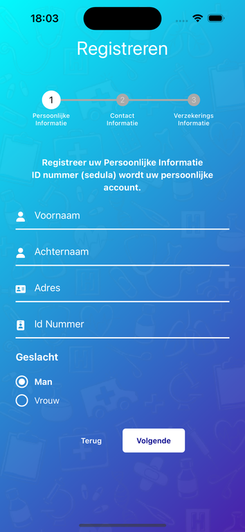
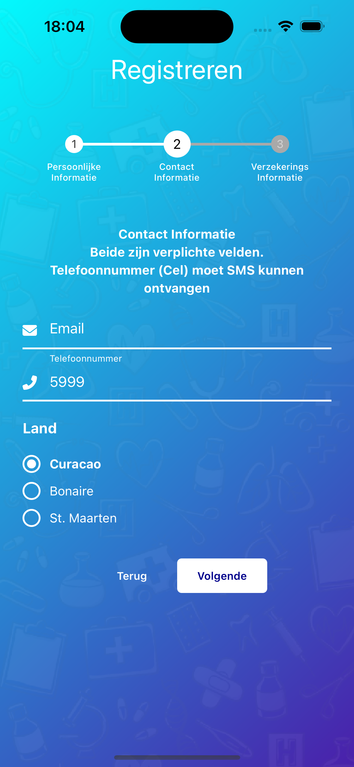
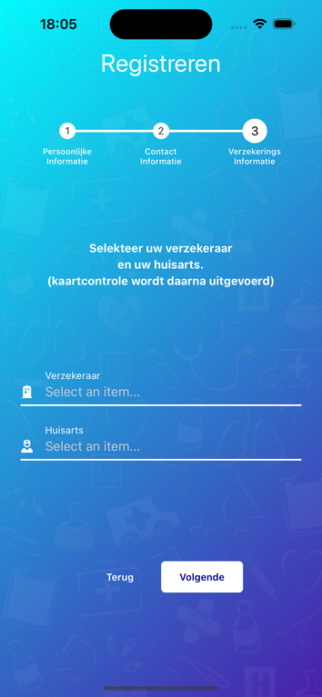
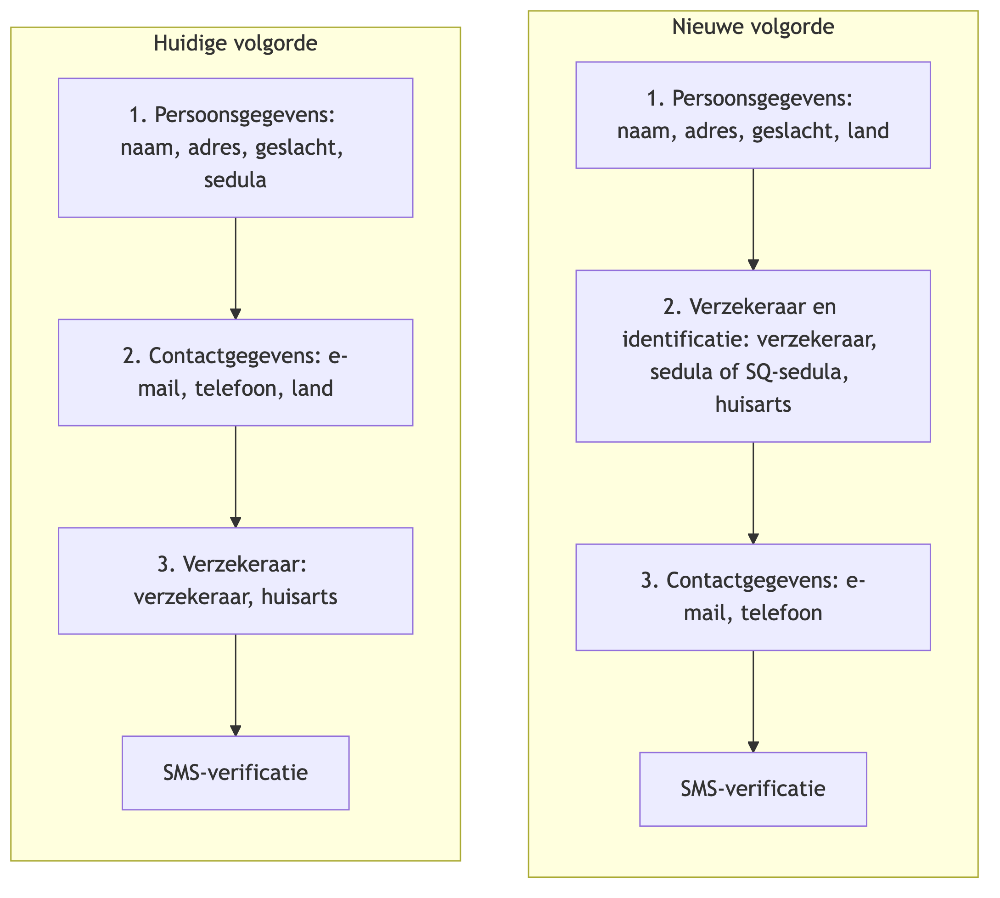
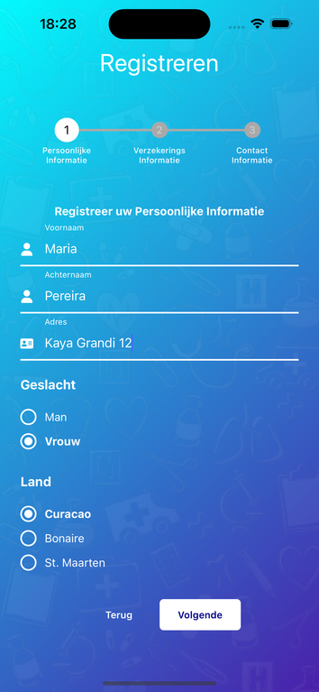
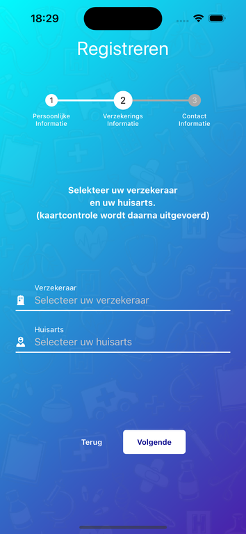
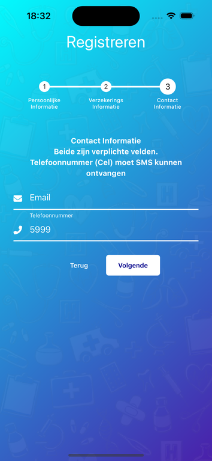
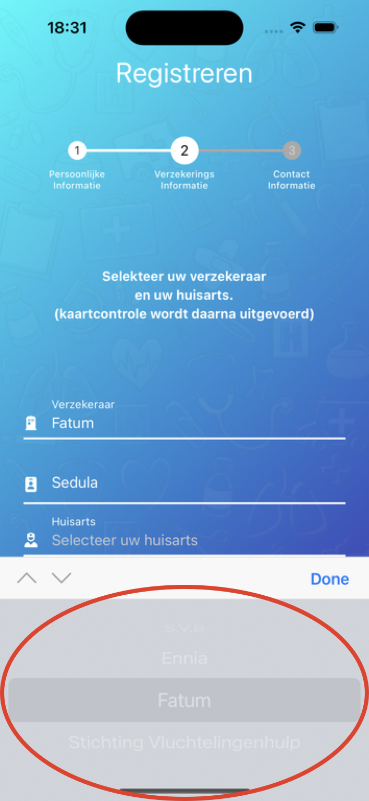
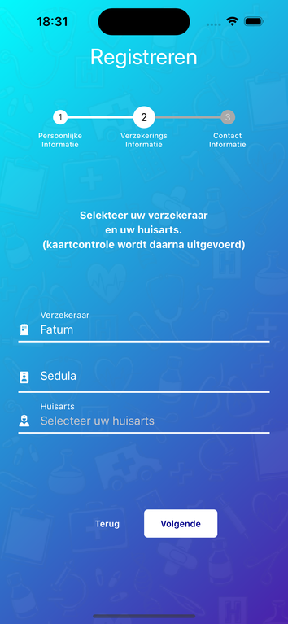
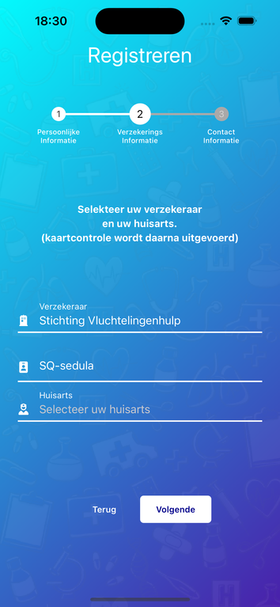

---
pdf_options:
  margin: 20mm 18mm 18mm 18mm
css: |-
  .markdown-body { font-size: 15px; line-height: 1.65; color: #2c3238; }
  h1 { color: #1EA8DE; border-bottom: 3px solid #1EA8DE; padding-bottom: 0.25em; margin-bottom: 0.8em; }
  h2 { color: #0F7BAA; border-bottom: 1px solid #dceef7; margin-top: 1.8em; }
  h3 { color: #3c4a55; }
  h2, h3 { page-break-after: avoid; }
  a { color: #0F7BAA; }
  table { page-break-inside: avoid; }
  table th { background: #1EA8DE; color: #fff; border-color: #1EA8DE; font-weight: 600; }
  table tr:nth-child(2n) { background: #f4fafd; }
  table.shots { width: 100%; border-collapse: collapse; margin: 1em 0; }
  table.shots tr, table.shots td { border: none; background: none; }
  table.shots td { padding: 6px 10px 14px; vertical-align: top; font-size: 0.85em; line-height: 1.35; color: #5b6770; }
  table.shots img { display: block; margin: 0 auto 6px; }
  .note { border-left: 4px solid #1EA8DE; background: #f2fafd; padding: 10px 16px; margin: 1.2em 0; border-radius: 0 4px 4px 0; page-break-inside: avoid; }
  .warn { border-left: 4px solid #d9534f; background: #fdf4f4; padding: 10px 16px; margin: 1.2em 0; border-radius: 0 4px 4px 0; page-break-inside: avoid; }
  .highlight { border-left: 4px solid #e6b800; background: #fff8e1; padding: 10px 16px; margin: 1.2em 0; border-radius: 0 4px 4px 0; page-break-inside: avoid; font-weight: 700; }
  .note p, .warn p, .highlight p { margin: 0; }
  .note p + p, .warn p + p, .highlight p + p { margin-top: 0.6em; }
  .striptitle { font-size: 11px; font-weight: 700; color: #3c4a55; margin-top: 14px; }
  .strip { display: flex; border: 1px solid #cfd8dd; border-radius: 5px; overflow: hidden; margin: 4px 0 10px; page-break-inside: avoid; }
  .strip > div { flex-basis: 0; min-width: 66px; padding: 7px 2px; text-align: center; border-right: 1px solid #cfd8dd; }
  .strip > div:last-child { border-right: none; }
  .strip .fn { display: block; font-family: ui-monospace, Menlo, monospace; font-size: 7px; letter-spacing: -0.2px; font-weight: 700; overflow-wrap: anywhere; }
  .strip .fb { display: block; font-size: 8px; color: #7a868f; margin-top: 1px; }
  .strip .fv { display: block; font-size: 9px; margin-top: 5px; }
  .strip .chg { background: #1EA8DE; color: #fff; }
  .strip .chg .fb { color: #e2f4fc; }
  .strip .free { background: #fff3cd; }
  .strip .dim { background: #f4f6f7; color: #7a868f; }
---

# SQ-sedula en digitale handtekening

Hoofdstuk 1 tot en met 4 gaan over de registratie van SQ-sedula-gebruikers en hoofdstuk 5 over het SVB-nummer; beide raken dezelfde registratiestap. Hoofdstuk 12 beschrijft de digitale handtekening en staat daar volledig los van.

## 1. Waar gaat dit over

Vluchtelingen en migranten op Curacao en de overige ondersteunde landen hebben geen geldige sedula. Zij melden zich bij de betrokken organisatie en krijgen daar een speciaal nummer: de **SQ-sedula**. Met dat nummer moeten zij zich in de MiSalu-app kunnen registreren.

Vandaag kan dat niet. De app vraagt tijdens de registratie om een sedula, en die hebben deze mensen niet.

## 2. Het knelpunt in de huidige volgorde

De registratie bestaat uit drie stappen. Het ID-nummer wordt in stap 1 gevraagd, maar de verzekeraar pas in stap 3.

<table class="shots">
  <tr>
    <td align="center"><br>Stap 1: persoonlijke informatie</td>
    <td align="center"><br>Stap 2: contact informatie</td>
    <td align="center"><br>Stap 3: verzekerings informatie</td>
  </tr>
</table>

Dat is precies de verkeerde volgorde. Om te weten of iemand een sedula of een SQ-sedula moet invullen, moeten we eerst weten bij wie diegene verzekerd is. Op het moment dat de app in stap 1 om het nummer vraagt, weet de app dat nog niet.

De oplossing is daarom niet alleen een extra optie toevoegen, maar ook de volgorde van de stappen aanpassen.

## 3. De nieuwe volgorde



De verzekeraar wordt voortaan direct na de persoonsgegevens gevraagd, en het ID-nummer verhuist mee naar diezelfde stap. Daardoor staat het nummer direct onder de verzekeraarskeuze en past het veld zich aan op wat de gebruiker kiest.

De landkeuze verhuist mee naar stap 1. Die is namelijk nodig om de juiste huisartsen te kunnen tonen, en dat gebeurt nu in de stap die naar voren schuift.

## 4. Hoe het eruit komt te zien

De onderstaande schermen komen uit een werkend prototype. Dit is geen ontwerp maar de daadwerkelijke app, tijdelijk aangepast om te laten zien hoe het werkt.

<table class="shots">
  <tr>
    <td align="center"><br>Stap 1: persoonsgegevens, nu met land en zonder ID-veld</td>
    <td align="center"><br>Stap 2: nog geen verzekeraar gekozen</td>
    <td align="center"><br>Stap 3: contactgegevens</td>
  </tr>
</table>

In de keuzelijst met verzekeraars komt de organisatie erbij als extra optie. De gebruiker moet voortaan zelf een verzekeraar kiezen; zolang dat niet gebeurd is, verschijnt het veld voor het nummer niet.

<table class="shots">
  <tr>
    <td align="center"><br>De keuzelijst met de nieuwe optie</td>
    <td align="center"><br>Gewone verzekeraar: het veld heet <strong>Sedula</strong></td>
    <td align="center"><br>De organisatie: het veld heet <strong>SQ-sedula</strong></td>
  </tr>
</table>

<div class="note">

Dat verschil tussen de laatste twee schermen is de kern van deze functionaliteit. Kiest iemand een gewone verzekeraar, dan heet het veld **Sedula**. Kiest iemand de organisatie, dan heet hetzelfde veld **SQ-sedula**. Voor de gebruiker verandert er verder niets: het nummer heeft hetzelfde formaat van tien cijfers en wordt op dezelfde manier gecontroleerd.

</div>

De naam "Stichting Vluchtelingenhulp" in het prototype is een werknaam. Zie de openstaande vragen in hoofdstuk 9.

## 5. SVB-nummer

Dit is een tweede wijziging in dezelfde registratiestap, en staat inhoudelijk los van SQ-sedula.

### 5.1 Wat het is

SVB-verzekerden hebben naast hun sedula ook een SVB-nummer van negen cijfers. Vandaag wordt dat nummer niet apart vastgelegd: het systeem leidt de eerste acht cijfers af uit de sedula en vult het negende zelf aan met een `0`. Dat klopt in de meeste gevallen, maar niet bij iedereen.

Daarom leggen we het nummer voortaan apart vast en laten we de gebruiker het laatste cijfer zelf bevestigen. Voor SVB-verzekerden is dit verplicht.

### 5.2 De regel

Het nummer bestaat uit twee delen: de sedula zonder de eeuw, dus zonder de eerste twee cijfers, gevolgd door één handmatig cijfer.

<div class="striptitle">Sedula 1999051402 wordt SVB-nummer 990514020</div>
<div class="strip"><div style="flex-grow:2" class="dim"><span class="fn">19</span><span class="fb">de eeuw</span><span class="fv">vervalt</span></div><div style="flex-grow:8"><span class="fn">99051402</span><span class="fb">8 cijfers</span><span class="fv">afgeleid uit de sedula, vast</span></div><div style="flex-grow:1" class="chg"><span class="fn">0</span><span class="fb">1 cijfer</span><span class="fv">handmatig, standaard 0</span></div></div>

Het resultaat is altijd negen cijfers.

### 5.3 Wat de gebruiker ziet

In stap 2 verschijnt onder het sedula-veld een extra veld **SVB-nummer**, zodra SVB als verzekeraar gekozen is. De eerste acht cijfers staan er al in en zijn niet aanpasbaar; daarachter staat één invoervakje met een `0`. In de meeste gevallen hoeft de gebruiker dus niets te doen en kan hij direct door.

Op het profielscherm komt het nummer alleen-lezen onder het ID-nummer te staan, alleen zichtbaar voor SVB-verzekerden.

<div class="note">

Anders dan bij SQ-sedula herkent de app SVB aan het vaste verzekeraar-id `301`, en niet aan een veld uit de verzekeraarslijst. Dat is een bewuste keuze, omdat alleen SVB zo'n nummer kent. Komt er ooit een tweede partij met een eigen nummer bij, dan is dit het eerste dat naar de verzekeraarslijst verhuist.

</div>

### 5.4 Backendwijzigingen

**`POST /auth-rn1/saveAppUser`** krijgt een nieuw veld met alle negen cijfers. De sedula blijft ongewijzigd in `idNummer`:

```json
{
  "idNummer": "1999051402",
  "svbNummer": "990514020",
  "verzekeringsId": 301
}
```

**Het `apuuser`-object** geeft `svbNummer` terug, net als `idType`, en om dezelfde reden: de app haalt het profiel nergens opnieuw op. Dus op `saveAppUser`, `login` én `checkLicense`:

```json
{
  "access": {
    "apuuser": {
      "idNummer": "1999051402",
      "svbNummer": "990514020",
      "vzkId": 301
    }
  }
}
```

**Bestaande SVB-gebruikers** worden eenmalig door de backend aangevuld met de afleiding plus een `0`, waarbij de backend de bekende uitzonderingen zelf corrigeert. De app doet daar niets voor en niemand wordt met een extra scherm lastiggevallen.

**Nieuwe vertaalsleutels** via `GET /lang-rn1/talen/{lng}`, in alle vijf talen:

| Sleutel | Gebruik |
| --- | --- |
| `register.svbNumber` | label van het veld in stap 2 |
| `profile.svbNumber` | label op het profielscherm |

## 6. Wat er nodig is

### 6.1 Backend — concrete API-aanpassingen

Base-URL: `{API_URL}` (bijv. `https://misalu.live/ords/api`). Alle calls hieronder zijn `POST`.

De app matcht nergens op een hardgecodeerd verzekeraar-id of op een naam. Alles hangt af van het nieuwe veld `idType` (`SEDULA` | `SQSEDULA`). Ontbreekt `idType`, dan valt de app terug op `SEDULA`.

#### 6.1.1 Verzekeraarslijst — `POST /auth-rn1/lov`

**Request (ongewijzigd)**

```json
{ "lovId": 201 }
```

**Response vandaag** — de app leest `noName-201.lovs`:

```json
{
  "noName-201": {
    "lovs": [
      { "lovId": 201, "id": 300, "naam": "Fatum", "tabNaam": "VERZEKERING" },
      { "lovId": 201, "id": 301, "naam": "S.V.B", "tabNaam": "VERZEKERING" },
      { "lovId": 201, "id": 302, "naam": "Ennia", "tabNaam": "VERZEKERING" }
    ],
    "status": { "code": 0, "msg": "OK" }
  }
}
```

**Response verwacht** — per regel `idType` erbij, plus een nieuwe regel voor de organisatie:

```json
{
  "noName-201": {
    "lovs": [
      { "lovId": 201, "id": 300, "naam": "Fatum", "tabNaam": "VERZEKERING", "idType": "SEDULA" },
      { "lovId": 201, "id": 301, "naam": "S.V.B", "tabNaam": "VERZEKERING", "idType": "SEDULA" },
      { "lovId": 201, "id": 302, "naam": "Ennia", "tabNaam": "VERZEKERING", "idType": "SEDULA" },
      { "lovId": 201, "id": 305, "naam": "Stichting Vluchtelingenhulp", "tabNaam": "VERZEKERING", "idType": "SQSEDULA" }
    ],
    "status": { "code": 0, "msg": "OK" }
  }
}
```

| Wat | Detail |
| --- | --- |
| Bestaande verzekeraars | krijgen `idType: "SEDULA"` |
| Nieuwe organisatie | nieuwe regel met `idType: "SQSEDULA"` |
| `id` | vrij te kiezen; `305` is een voorbeeld |
| `naam` | definitieve weergavenaam in de keuzelijst (niet vertaalbaar per taal) |

#### 6.1.2 Nummercontrole — `POST /auth-rn1/checkSedula`

**Request vandaag**

```json
{ "sedula": "1234567890", "taal": "NL" }
```

**Request verwacht**

```json
{
  "sedula": "1234567890",
  "taal": "NL",
  "verzekeringsId": 305,
  "idType": "SQSEDULA"
}
```

| `idType` | Gedrag |
| --- | --- |
| `SEDULA` | valideren tegen het nationale register (huidig gedrag) |
| `SQSEDULA` | valideren tegen het register van de organisatie |

**Response (vorm ongewijzigd)** — de app toont `check.status.msg` ongewijzigd aan de gebruiker:

```json
{
  "check": {
    "status": { "code": 0, "msg": "OK" }
  }
}
```

Foutvoorbeeld (nummer niet gevonden):

```json
{
  "check": {
    "status": { "code": 1, "msg": "SQ-sedula niet gevonden" }
  }
}
```

`msg` moet in de meegegeven `taal` terugkomen (NL, EN, ES, PA, CH).

#### 6.1.3 Registratie — `POST /auth-rn1/saveAppUser`

**Request vandaag** (relevante velden):

```json
{
  "roepNaam": "Maria",
  "naam": "Pereira",
  "telefoonNummer": "59991234567",
  "idNummer": "1234567890",
  "adres": "...",
  "lndKode": "CW",
  "verzekeringsId": 302,
  "doctorId": 123,
  "language": "NL",
  "sex": "F",
  "email": "maria@example.com"
}
```

**Request verwacht** — zelfde payload. Het nummer blijft in `idNummer`; er komt geen apart veld. `verzekeringsId` mag het id van de organisatie zijn.

**Response vandaag** — relevante snede van `access.apuuser`:

```json
{
  "access": {
    "apuuser": {
      "apuId": 12345,
      "idNummer": "1234567890",
      "vzkId": 302,
      "vzkNaam": "Fatum",
      "needPhotoId": 2
    },
    "licentie": { }
  }
}
```

**Response verwacht** — `idType` op `apuuser`, en voor SQ-sedula `needPhotoId: 1`:

```json
{
  "access": {
    "apuuser": {
      "apuId": 12345,
      "idNummer": "1234567890",
      "vzkId": 305,
      "vzkNaam": "Stichting Vluchtelingenhulp",
      "idType": "SQSEDULA",
      "needPhotoId": 1
    },
    "licentie": { }
  }
}
```

| `needPhotoId` | Route in de app |
| --- | --- |
| `1` | handmatige fotocontrole (gewenst voor SQ-sedula) |
| `2` | Onfido (niet geschikt voor deze doelgroep) |

#### 6.1.4 `idType` ook op login en license-check

De app haalt het profiel nergens opnieuw op. Het `apuuser`-object uit deze responses wordt lokaal bewaard en is de bron voor profiel en QR-code. Daarom moet `idType` ook terugkomen op:

- `POST /auth-rn1/login` → `access.apuuser.idType`
- `POST /auth-rn1/checkLicense` → `check.apuuser.idType`

Zonder dat blijft het label na een herinstallatie of opnieuw inloggen altijd "Sedula", ook voor SQ-sedula-gebruikers.

#### 6.1.5 Vertalingen — `GET /lang-rn1/talen/{lng}`

Nieuwe sleutels in alle vijf talen (NL, EN, ES, PA, CH), voordat de app-release live gaat:

| Sleutel | Gebruik |
| --- | --- |
| `register.sqSedulaNumber` | label van het invoerveld |
| `register.sqSedulaRequired` | foutmelding, veld leeg |
| `register.sqSedulaLength` | foutmelding, niet exact 10 tekens |
| `register.sqSedulaExistOfNumbers` | foutmelding, niet numeriek |
| `register.selectInsurer` | placeholder in de verzekeraarslijst |
| `profile.sqSedulaNumber` | label op het profielscherm |
| `identify.sqSedula` | label bij de QR-code |

### 6.2 Aan de kant van de app

1. De volgorde van de drie registratiestappen aanpassen, inclusief het verplaatsen van de landkeuze.
2. Het ID-veld verplaatsen naar de stap met de verzekeraar, en het label laten meebewegen met `idType` van de gekozen verzekeraar.
3. De verzekeraarskeuze verplicht maken in plaats van automatisch de eerste optie invullen.
4. Op het profielscherm en bij de QR-code de juiste benaming tonen op basis van `user.idType`.
5. Een aantal correcties meenemen, zie hoofdstuk 8.

<div class="note">

**Belangrijk voor de planning.** De app kan pas volledig getest worden als LOV 201 `idType` levert, `checkSedula` de extra velden accepteert, en `saveAppUser`/`login`/`checkLicense` `idType` op `apuuser` teruggeven. De vertalingen moeten klaar zijn voordat de app-versie live gaat, anders ziet de gebruiker lege teksten.

</div>

## 7. Identiteitscontrole

Na de registratie moet een gebruiker zijn identiteit aantonen. Dat gebeurt op dit moment op twee manieren: een foto van het identiteitsbewijs die door een medewerker wordt beoordeeld (`needPhotoId: 1`), of een automatische controle via Onfido (`needPhotoId: 2`).

Voor deze doelgroep stellen we `needPhotoId: 1` voor. Onfido kijkt naar paspoorten en nationale identiteitsbewijzen, en dat is nu juist wat deze mensen niet hebben. Onfido zou dus vrijwel altijd mislukken.

De app hoeft hiervoor niets te veranderen; de routering leest al `needPhotoId` uit het `apuuser`-object van `saveAppUser`.

<div class="note">

**Aandachtspunt voor jou.** Dit betekent wel dat er meer handmatige beoordelingen bijkomen. Is dat qua volume werkbaar?

</div>

## 8. Problemen die we tegenkwamen

Tijdens het uitzoeken zijn drie bestaande fouten gevonden. Ze staan los van deze functionaliteit, maar twee ervan raken we sowieso aan en één is blokkerend.

<div class="warn">

**De app crasht bij een nieuwe verzekeraar (blokkerend).** De app kent op dit moment alleen S.V.B, Ennia en Fatum. Zodra een gebruiker bij een verzekeraar hoort die de app niet kent, klapt het dashboard eruit direct na het afronden van de registratie. Omdat we met de organisatie precies zo'n nieuwe partij toevoegen, moet dit hoe dan ook opgelost worden. Het is meteen opgelost voor elke toekomstige verzekeraar.

</div>

Daarbij hoort ook een keuze over de huisstijl. De organisatie krijgt geen eigen logo en kleuren, maar het standaard MiSalu-blauw.

**Het geslacht wordt verkeerd opgeslagen.** In elke taal behalve Nederlands wordt op dit moment iedere gebruiker als vrouw geregistreerd. Dit zit in het scherm dat we toch aanpassen.

**Foutmeldingen komen niet in de eigen taal terug.** De gekozen taal wordt bij de controle van het nummer niet meegestuurd. Juist voor deze doelgroep is dat vervelend: dat is de melding die iemand krijgt als het SQ-nummer niet gevonden wordt.

## 9. Openstaande vragen

1. Wat tonen we in de verzekeraarsdropdown als label voor de organisatie? Deze tekst komt uit `naam` in LOV 201 en is voor alle talen hetzelfde (niet vertaalbaar).

<div class="highlight">

2. Wat gebeurt er als iemand later alsnog een echte sedula krijgt? Moet zo iemand kunnen overstappen, en zo ja, hoe?

</div>

## 10. Wat we nu niet doen

- **Machtigingen (Mandansa).** Dat is een apart registratieformulier met een eigen ID-veld. Als een gemachtigde ook een SQ-sedula kan hebben, is dat een logische vervolgstap.
- **Inloggen.** Daar verandert niets. Inloggen gaat via het e-mailadres, niet via het ID-nummer.
- **Registratie via een licentiecode of QR.** In deze eerste versie registreren deze gebruikers zich via de app.

## 11. Voorstel voor de opdeling

### Backend

| # | Endpoint / onderwerp | Omschrijving |
| --- | --- | --- |
| 1 | `POST /auth-rn1/lov` (lovId 201) | Organisatie toevoegen; `idType` op elke regel (`SEDULA` / `SQSEDULA`) |
| 2 | `POST /auth-rn1/checkSedula` | Request uitbreiden met `verzekeringsId` + `idType`; valideren tegen het juiste register |
| 3 | `saveAppUser` / `login` / `checkLicense` | `idType` op `apuuser` teruggeven; nummer blijft in `idNummer` |
| 4 | `saveAppUser` → `needPhotoId` | Voor `idType: SQSEDULA` altijd `needPhotoId: 1` |
| 5 | `saveAppUser` / `login` / `checkLicense` | `svbNummer` opslaan en teruggeven op `apuuser` |
| 6 | Bestaande SVB-gebruikers | Eenmalig aanvullen met de afleiding plus `0`, uitzonderingen corrigeren |
| 7 | `GET /lang-rn1/talen/{lng}` | Nieuwe sleutels in NL, EN, ES, PA, CH |

### App

| # | Omschrijving |
| --- | --- |
| 1 | De volgorde van de registratiestappen aanpassen, inclusief de landkeuze |
| 2 | Het ID-veld verplaatsen en het label laten meebewegen met `idType` |
| 3 | De verzekeraarskeuze verplicht maken |
| 4 | Het SVB-nummerveld in stap 2, met vaste eerste acht cijfers en één invoerbaar cijfer |
| 5 | De juiste benaming tonen op het profiel en bij de QR-code, plus het SVB-nummer alleen-lezen op het profiel |
| 6 | De crash bij een onbekende verzekeraar oplossen |
| 7 | De correcties op geslacht en taal meenemen |

Voor de app-kant (bestanden, types, hooks) staat een uitgewerkte technische versie naast dit document.

## 12. Digitale handtekening

Dit hoofdstuk staat volledig los van de registratie en van SQ-sedula. Het kan apart gepland en apart opgeleverd worden.

### 12.1 Wat het is

Een permanent identiteitsbewijs van de patiënt in de vorm van een QR-code. De apotheek scant hem om vast te leggen dat déze patiënt aan de balie stond en akkoord is. De code bevat geen recept en start geen transactie in de app.

De inhoud is voor elke patiënt vast: dezelfde gegevens, op elk toestel, zonder vervaldatum. De app bouwt de code volledig offline op uit gegevens die hij al heeft, dus er is geen internetverbinding nodig en de backend hoeft niets uit te geven of te onthouden.

### 12.2 Wat de gebruiker ziet

Op de receptenpagina komt een floating action button rechtsonder. Het component daarvoor bestaat al en wordt elders in de app op dezelfde manier gebruikt.

1. De gebruiker tikt op de knop.
2. De app vraagt om biometrie, net als bij de bestaande QR-code.
3. Er opent een scherm "Digitale handtekening" met de QR-code en daaronder naam, ID-nummer (Sedula of SQ-sedula, conform hoofdstuk 6) en verzekeraar.

**Machtigingen (Mandansa) vallen buiten de MVP.** De receptenpagina wordt ook gebruikt om via een machtiging de recepten van iemand anders te bekijken. In deze eerste versie ondersteunen we dat niet: in die context verschijnt de knop niet. De handtekening hoort bij de ingelogde patiënt.

### 12.3 Opbouw van de code

<div class="note">

**De enige wijziging aan het formaat is een nieuw transactietype: `7`.** Verder verandert er niets. Dezelfde velden op dezelfde posities, dezelfde AES-128-GCM-versleuteling met dezelfde sleutel, dezelfde nonce-opbouw, dezelfde `magic` en `version`, en dezelfde QR-waarde `nonce + ciphertext + authTag`. Alleen de invulling van de velden verschilt.

</div>

De buitenkant van de QR-waarde blijft ongewijzigd:

<div class="strip"><div style="flex-grow:12" class="dim"><span class="fn">nonce</span><span class="fb">12 bytes</span><span class="fv">tijdstip</span></div><div style="flex-grow:26"><span class="fn">ciphertext</span><span class="fb">versleutelde inhoud</span><span class="fv">zie hieronder</span></div><div style="flex-grow:16" class="dim"><span class="fn">authTag</span><span class="fb">16 bytes</span><span class="fv">controlegetal</span></div></div>

De versleutelde inhoud zoals die vandaag wordt opgebouwd:

<div class="striptitle">Bestaande QR (kaartcontrole, recept, labaanvraag, machtiging)</div>
<div class="strip"><div style="flex-grow:8"><span class="fn">ownerId</span><span class="fb">8 bytes</span><span class="fv">apuId</span></div><div style="flex-grow:4"><span class="fn">mdsId</span><span class="fb">4 bytes</span><span class="fv">machtiging</span></div><div style="flex-grow:4"><span class="fn">alternativeData</span><span class="fb">4 bytes</span><span class="fv">recId / avaId</span></div><div style="flex-grow:3"><span class="fn">transactionId</span><span class="fb">3 bytes</span><span class="fv">willekeurig</span></div><div style="flex-grow:1"><span class="fn">flag</span><span class="fb">1 byte</span><span class="fv">online</span></div><div style="flex-grow:1" class="chg"><span class="fn">transactionType</span><span class="fb">1 byte</span><span class="fv">1, 2, 4, 5, 6</span></div><div style="flex-grow:5"><span class="fn">reserved</span><span class="fb">5 bytes</span><span class="fv">bestaand gebruik</span></div><div style="flex-grow:4"><span class="fn">magic + version</span><span class="fb">vast</span><span class="fv">uit config</span></div></div>

Dezelfde inhoud voor de digitale handtekening:

<div class="striptitle">Digitale handtekening (nieuw)</div>
<div class="strip"><div style="flex-grow:8"><span class="fn">ownerId</span><span class="fb">8 bytes</span><span class="fv">apuId</span></div><div style="flex-grow:4"><span class="fn">mdsId</span><span class="fb">4 bytes</span><span class="fv">0</span></div><div style="flex-grow:4"><span class="fn">alternativeData</span><span class="fb">4 bytes</span><span class="fv">0</span></div><div style="flex-grow:3"><span class="fn">transactionId</span><span class="fb">3 bytes</span><span class="fv">0</span></div><div style="flex-grow:1"><span class="fn">flag</span><span class="fb">1 byte</span><span class="fv">0</span></div><div style="flex-grow:1" class="chg"><span class="fn">transactionType</span><span class="fb">1 byte</span><span class="fv">7</span></div><div style="flex-grow:5" class="free"><span class="fn">reserved</span><span class="fb">5 bytes</span><span class="fv">leeg, vrije ruimte</span></div><div style="flex-grow:4"><span class="fn">magic + version</span><span class="fb">vast</span><span class="fv">uit config</span></div></div>

Het blauwe veld is de enige echte wijziging: aan `transactionType: 7` herkent de scanzijde dat het om een digitale handtekening gaat. Alle posities en lengtes blijven gelijk, dus er hoeft alleen op dat veld gebranched te worden.

`transactionId` staat op nul omdat er geen transactie gestart wordt waar de app op wacht, en `flag` staat op nul omdat de code geen internetverbinding nodig heeft.

Het gele veld is de vrije ruimte: vijf bytes die voor dit type leeg blijven en die we later kunnen invullen zonder het formaat te wijzigen. De payload blijft daarmee byte-voor-byte even lang als vandaag.

### 12.4 Wat de scanzijde moet doen

De app roept hiervoor niets aan bij de backend. Aan de scanzijde is wel het volgende nodig:

| # | Punt |
| --- | --- |
| 1 | Transactietype `7` herkennen als digitale handtekening |
| 2 | `ownerId` vertalen naar de patiënt en de handtekening vastleggen |
| 3 | De vijf bytes in `reserved` negeren; die zijn gereserveerd voor later |
| 4 | Naam en ID-nummer teruggeven aan de baliemedewerker, zodat die kan vergelijken met wat de patiënt op het scherm toont |

Twee gevolgen om rekening mee te houden. De app hoort na het tonen van de code niets meer terug, want er is geen transactie om op te pollen. En `transactionId` staat op nul, dus dat veld kan niet gebruikt worden om dubbele scans te herkennen; de scanzijde moet daar zelf iets voor regelen.

### 12.5 Risico's

<div class="warn">

**Een handtekening kan niet ingetrokken worden.** De app bouwt de code zelf op, dus er valt centraal niets ongeldig te verklaren. Raakt een screenshot bij de verkeerde persoon, dan is de enige remedie het account blokkeren.

</div>

We accepteren dit voor de eerste versie. De feitelijke beveiliging zit aan de balie: de medewerker ziet de naam en het ID-nummer die de scanner teruggeeft en kan die vergelijken met de persoon die voor hem staat. Daarom staan diezelfde gegevens ook onder de QR-code op het scherm.

Om later bij te sturen is er ruimte zonder het formaat te wijzigen: één van de vijf vrije bytes kan een volgnummer worden, waarmee de backend alle oudere codes in één keer ongeldig verklaart.

### 12.6 Opdeling

| # | Omschrijving |
| --- | --- |
| 1 | QR-opbouw voor transactietype `7`: vaste velden, vrije bytes op nul |
| 2 | Floating action button op de receptenpagina, zonder machtigingen (Mandansa), met biometrieprompt |
| 3 | Nieuw scherm "Digitale handtekening" met QR-code en infoblok |
| 4 | Scanzijde: transactietype `7` herkennen en de vrije bytes negeren |
| 5 | Vertaalsleutels aanleveren in de vijf talen |
