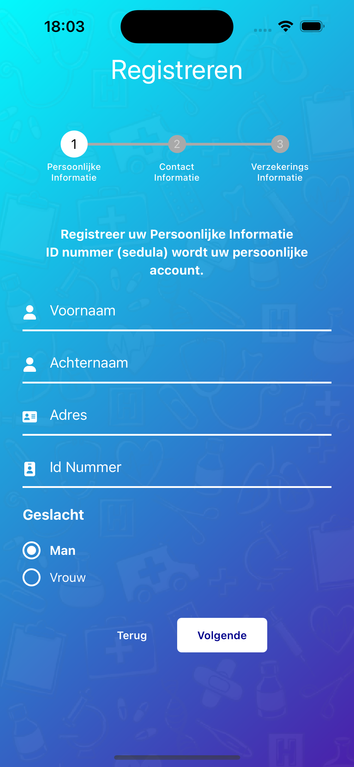
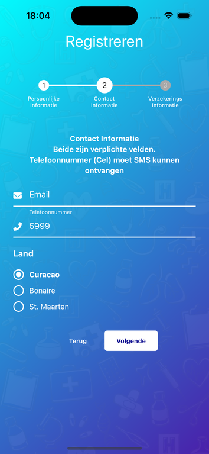
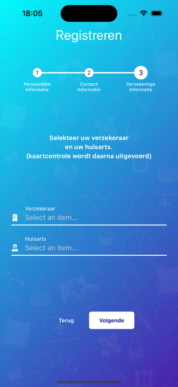
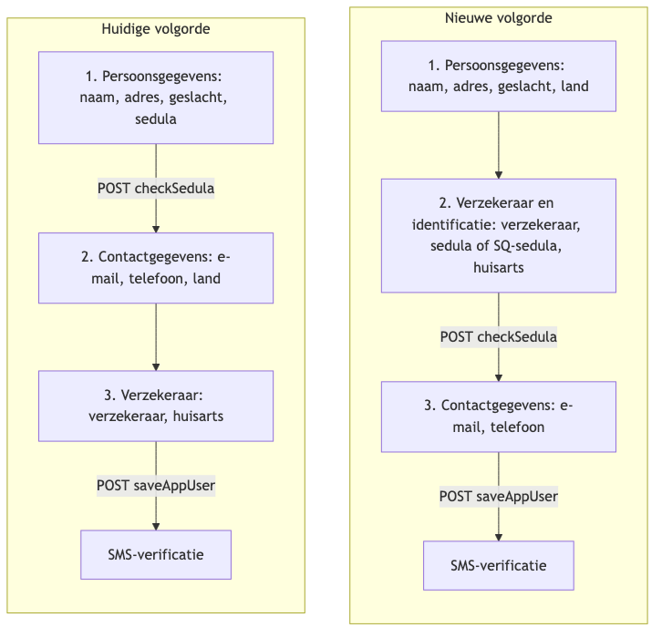
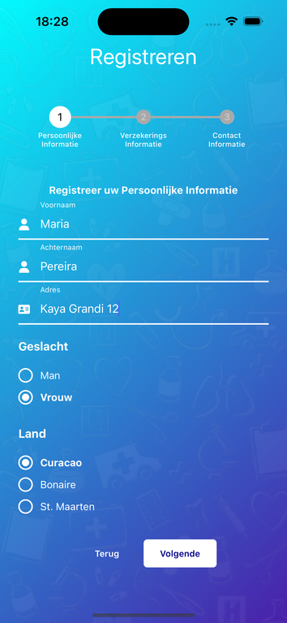
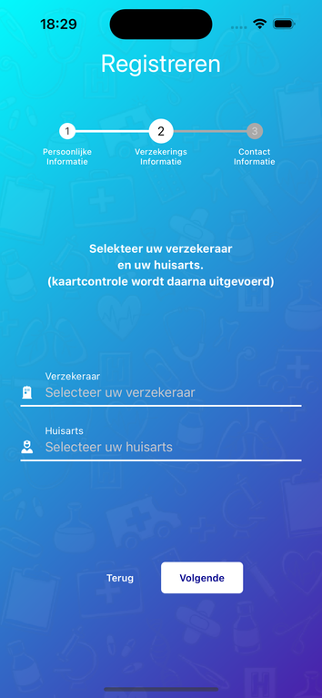
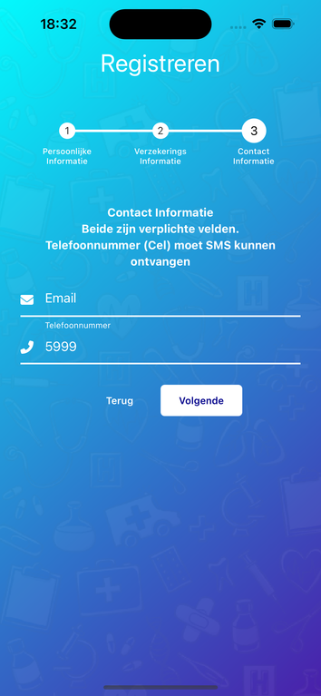
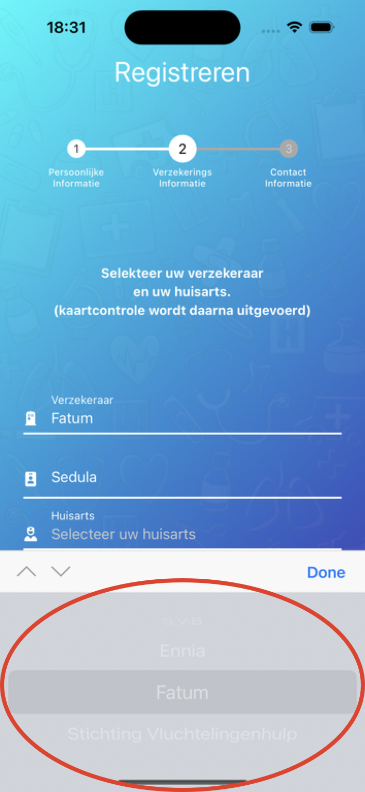
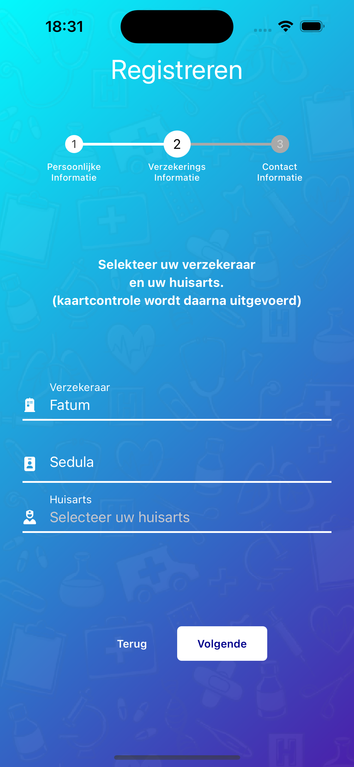
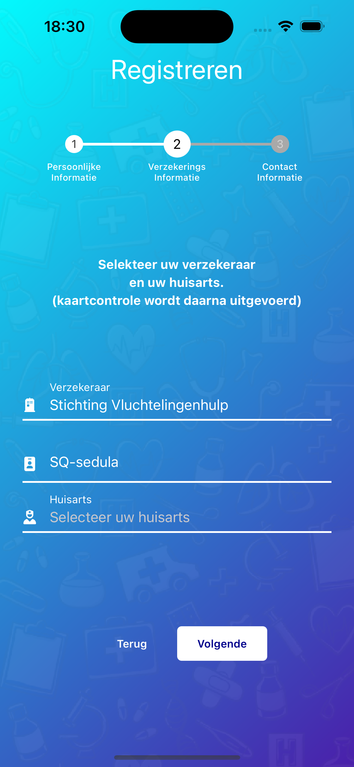

# SQ-sedula: wijzigingen registratieflow

- **Status:** voorstel ter review
- **Betreft:** MiSalu Mobile App (React Native) en de ORDS-backend
- **Datum:** 3 augustus 2026

## 1. Aanleiding

Vluchtelingen en migranten op Curacao (en de overige ondersteunde landen) beschikken niet over een geldige sedula. Zij melden zich bij de betrokken organisatie en krijgen daar een speciaal gegenereerd nummer, de **SQ-sedula**. Met dat nummer moeten zij zich in de MiSalu-app kunnen registreren.

Om dit mogelijk te maken moet de registratieflow worden aangepast. Het kernprobleem is de volgorde: de app vraagt het ID-nummer nu in stap 1, terwijl de verzekeraar pas in stap 3 wordt gevraagd. De app kan dus op het moment dat het ID-veld getoond wordt nog niet weten of het om een sedula of om een SQ-sedula gaat.

## 2. Uitgangspunten

Deze besluiten zijn vooraf vastgelegd en vormen de basis van dit document.

| Onderwerp | Besluit |
| --- | --- |
| Naamgeving | Het veld heet **SQ-sedula** |
| Formaat | Identiek aan de sedula: exact 10 cijfers, numeriek |
| Herkenning | De backend levert per verzekeraar een veld `idType` met waarde `SEDULA` of `SQSEDULA` |
| Opslag | De waarde gaat mee in het bestaande veld `idNummer`; er komt geen apart nummerveld |
| Servercontrole | Blijft op `POST /auth-rn1/checkSedula`, uitgebreid met `verzekeringsId` en `idType` |
| Identiteitsverificatie | SQ-sedula-gebruikers krijgen `needPhotoId = 1` (handmatige fotocontrole), geen Onfido |
| Registratieroute | Alleen registratie via de app in v1; de licentie- of QR-route wijzigt niet |
| Terugvalgedrag | Ontbreekt `idType`, dan gedraagt de app zich als `SEDULA` |

De organisatie wordt dus een gewone regel in de bestaande verzekeraarslijst (LOV 201). De app matcht nergens op een hardgecodeerd id of op een naam. Dit vervangt het eerdere prototype uit `REGISTRATION_IDENTIFICATION_FLOW_NOTES.md`, waarin een aparte ja/nee-vraag "Heeft u een migrantenpolis?" alleen aan Fatum-achtige verzekeraars werd gesteld en Fatum werd herkend via `naam.toLowerCase().includes('fatum')`.

## 3. Huidige situatie

Hieronder de drie stappen van de registratie via de app, opgenomen uit de huidige versie op de simulator.

<table>
  <tr>
    <td align="center"><br>Stap 1: persoonlijke informatie</td>
    <td align="center"><br>Stap 2: contact informatie</td>
    <td align="center"><br>Stap 3: verzekerings informatie</td>
  </tr>
</table>

Drie observaties die direct relevant zijn:

1. **Stap 1** vraagt het ID-nummer ("Id Nummer"), met daarboven de tekst "ID nummer (sedula) wordt uw persoonlijke account". Dit gebeurt voordat de verzekeraar bekend is.
2. **Stap 2** bevat de landkeuze ("Land"). Dat veld is nodig voor de huisartsenlijst in stap 3.
3. **Stap 3** toont bij beide keuzelijsten "Select an item...". De verzekeraarslijst wordt asynchroon geladen, waardoor de standaardwaarde niet betrouwbaar wordt gezet.

## 4. Nieuwe volgorde



De verzekeraar verhuist van stap 3 naar stap 2, en het ID-veld verhuist mee van stap 1 naar stap 2. Daardoor staat het ID-veld direct onder de verzekeraarskeuze en kan het label meebewegen met de gekozen verzekeraar.

Twee gevolgen die niet over het hoofd gezien mogen worden:

- **De landkeuze moet mee naar stap 1.** De huisartsenlijst filtert op `user.lndKde` (`doctors.filter(x => x.lndKde === user.lndKde)`), en dat veld wordt vandaag pas gezet bij het versturen van de contactgegevens. Als de verzekeraarsstap naar voren schuift zonder de landkeuze mee te nemen, blijft de huisartsenlijst leeg. Het land hoort inhoudelijk ook bij de persoonsgegevens, naast het adres.
- **De API-aanroepen verschuiven mee.** `checkSedula` gaat van stap 1 naar stap 2, `saveAppUser` van stap 2 naar stap 3.

### 4.1 Werkend prototype

De onderstaande schermen komen uit een werkend prototype op de simulator, waarin de nieuwe volgorde en het verzekeraarsgestuurde ID-veld daadwerkelijk zijn ingebouwd. Het prototype is uitsluitend gemaakt om deze schermafbeeldingen te kunnen maken en is daarna volledig teruggedraaid; er staat geen prototypecode in de codebase.

<table>
  <tr>
    <td align="center"><br>Stap 1: persoonsgegevens, nu met land en zonder ID-veld</td>
    <td align="center"><br>Stap 2: nog geen verzekeraar gekozen, ID-veld verborgen</td>
    <td align="center"><br>Stap 3: contactgegevens, zonder land</td>
  </tr>
</table>

In stap 1 is het ID-veld verdwenen en staat de landkeuze onder het geslacht. Dat de landkeuze inderdaad eerder bekend is, blijkt in stap 3: het telefoonnummer wordt vooringevuld met prefix `5999` op basis van de landkeuze uit stap 1.

De voortgangsbalk toont nu de juiste volgorde: persoonlijke informatie, verzekerings informatie, contact informatie.

### 4.2 De keuzelijst met de nieuwe optie

De verzekeraarslijst bevat naast de bestaande verzekeraars een regel voor de organisatie. Doorgaan is pas mogelijk na een expliciete keuze; zolang er niets gekozen is, toont het veld de placeholder en blijft het ID-veld verborgen.

<table>
  <tr>
    <td align="center"><br>De geopende keuzelijst met de nieuwe optie</td>
    <td align="center"><br>Gewone verzekeraar: het veld heet <strong>Sedula</strong></td>
    <td align="center"><br>De organisatie: het veld heet <strong>SQ-sedula</strong></td>
  </tr>
</table>

Het verschil tussen de laatste twee schermen is precies wat deze functionaliteit oplevert: bij een gewone verzekeraar (`idType: SEDULA`) heet het veld Sedula, en bij de organisatie (`idType: SQSEDULA`) heet hetzelfde veld SQ-sedula. De gebruiker hoeft verder niets anders te doen en de validatie blijft identiek.

De naam "Stichting Vluchtelingenhulp" in het prototype is een werknaam. De definitieve naam komt uit het veld `naam` van de nieuwe regel in LOV 201, zie ook punt 1 in hoofdstuk 10.

## 5. Backendwijzigingen

### 5.1 Verzekeraarslijst (LOV 201)

`POST /auth-rn1/lov` met `{ lovId: 201 }` levert nu regels in de vorm `{ lovId, id, naam, tabNaam }`. Daar komt een veld bij:

```json
{ "lovId": 201, "id": 305, "naam": "...", "tabNaam": "...", "idType": "SQSEDULA" }
```

Alle bestaande verzekeraars krijgen `idType: "SEDULA"`. Daarnaast wordt de organisatie als nieuwe regel toegevoegd met `idType: "SQSEDULA"`.

### 5.2 Controle van het nummer

`POST /auth-rn1/checkSedula` ontvangt nu `{ sedula, taal }`. Dat wordt:

```json
{ "sedula": "1234567890", "taal": "NL", "verzekeringsId": 305, "idType": "SQSEDULA" }
```

De backend bepaalt op basis hiervan tegen welk register gevalideerd wordt: het nationale register bij `SEDULA`, het register van de organisatie bij `SQSEDULA`. De foutmelding in `check.status.msg` wordt door de app ongewijzigd aan de gebruiker getoond en moet dus in de meegegeven taal terugkomen.

### 5.3 Registratie en gebruikersobject

- `POST /auth-rn1/saveAppUser` accepteert het id van de organisatie in `verzekeringsId`. Het nummer komt binnen in het bestaande veld `idNummer`.
- Het teruggegeven `apuuser`-object krijgt een veld `idType` met waarde `SEDULA` of `SQSEDULA`.
- Datzelfde veld moet ook terugkomen op `apuuser` bij `POST /auth-rn1/checkLicense` en `POST /auth-rn1/login`. De app haalt het profiel namelijk nergens opnieuw op: het gebruikersobject uit deze responses wordt lokaal opgeslagen en is de bron voor alle vervolgschermen.

### 5.4 Identiteitsverificatie

Voor registraties met een SQ-sedula levert de backend `needPhotoId = 1`. De gebruiker doorloopt dan de handmatige fotocontrole in plaats van Onfido. Onfido controleert paspoorten en nationale identiteitsdocumenten en is daarmee niet geschikt voor deze doelgroep.

Aan de app-kant is hiervoor geen wijziging nodig; de routering is al volledig backend-gestuurd:

```343:349:src/features/Auth/screens/register.screen.tsx
        setStep(
          state.user?.needPhotoId === 1
            ? Steps.uploadId
            : state.user?.needPhotoId === 2
            ? Steps.OnfidoDocumentVerification
            : Steps.SetPin,
        );
```

### 5.5 Vertalingen

De app haalt alle teksten op via `${API_URL}/lang-rn1/talen/{lng}`; er staan geen vertaalbestanden in de repository. De nieuwe sleutels moeten daarom door de backend geleverd worden in alle vijf de talen (NL, EN, ES, PA, CH) voordat de app-release live gaat. Zie hoofdstuk 7.

## 6. Frontendwijzigingen

### 6.1 Stap 1, persoonsgegevens

Bestand: `src/features/Auth/screens/steps/enterPersonalInfo.step.tsx`

- Het veld `idNumber` en de bijbehorende Yup-regel verdwijnen hier.
- De aanroep van `checkSedula` verdwijnt hier.
- De landkeuze (`RadioButtonGroup` met `COUNTRIES`) komt hierheen vanuit de contactstap en zet `lndKde` op de gebruiker.
- "Volgende" gaat naar `Steps.EnterInsuranceInfo`.

### 6.2 Stap 2, verzekeraar en identificatie

Bestand: `src/features/Auth/screens/steps/enterInsuranceInformation.step.tsx`

- De keuzelijst wordt gecontroleerd (`value={selectedInsurerId}`) en krijgt een placeholder "Selecteer uw verzekeraar" op waarde `0`. Doorgaan is pas mogelijk na een expliciete keuze. Dit is dezelfde opzet als de huisartsenlijst al gebruikt.
- Het ID-veld wordt pas getoond zodra een verzekeraar gekozen is. Label en foutmeldingen volgen `idType` van de gekozen regel.
- De stap krijgt Formik met de bestaande validatie (verplicht, numeriek, exact 10 tekens). Het formaat is voor beide typen gelijk, dus de regel zelf verandert niet.
- Bij verzenden wordt `checkSedula` aangeroepen met `{ sedula, taal, verzekeringsId, idType }`.

Huidige regel die vervalt:

```37:37:src/features/Auth/screens/steps/enterInsuranceInformation.step.tsx
  const [selectedInsurerId, setSelectedInsurerId] = useState(insurers[0]?.id);
```

### 6.3 Stap 3, contactgegevens

Bestand: `src/features/Auth/screens/steps/enterContactInfo.step.tsx`

- De landkeuze verdwijnt hier; het telefoonprefix wordt afgeleid van `user.lndKde`.
- Deze stap sluit de registratie af en roept `registerUser` (`saveAppUser`) aan.

### 6.4 Aansturing van de flow

Bestand: `src/features/Auth/screens/register.screen.tsx`

- `inAppRegistrationTrackerSteps` (regel 257) wordt herordend naar persoonsgegevens, verzekeraar, contactgegevens, zodat de voortgangsbalk klopt.
- In het `checkSedula`-effect gaat de foutafhandeling terug naar `Steps.EnterInsuranceInfo` in plaats van `Steps.EnterPersonalInfo`:

```386:397:src/features/Auth/screens/register.screen.tsx
  useEffect(() => {
    if (checkSedulaStatus === 'success') {
      setStep(Steps.EnterContactInfo);
    }

    if (checkSedulaStatus === 'error') {
      const responseStatus = checkSedulaError?.response?.data.check.status;

      Alert.alert('error', responseStatus?.msg ?? 'Something went wrong');
      setStep(Steps.EnterPersonalInfo);
    }
  }, [checkSedulaError, checkSedulaStatus]);
```

- De foutafhandeling van `registerUser` (regel 426) verwijst nu naar `Steps.EnterInsuranceInfo` en moet naar de contactstap gaan.
- De props `insurers`, `doctors` en de mutatie `checkSedula` worden doorgegeven aan de stappen die ze na de herordening nodig hebben.

### 6.5 Types en services

| Bestand | Wijziging |
| --- | --- |
| `src/hooks/useFetchAllInsurers.ts` | `idType` toevoegen aan `LovInsurer` |
| `src/types/user.d.ts` | `idType` toevoegen aan `User` |
| `src/features/Auth/services/auth-service.ts` | `checkSedula` uitbreiden met `verzekeringsId` en `idType` |
| `src/features/Auth/hooks/useCheckSedula.ts` | parametertype bijwerken |
| `src/features/Auth/screens/auth.d.ts` | `CheckSedula`-types bijwerken |

Daarnaast komt er een kleine gedeelde helper die een `idType` vertaalt naar de bijbehorende vertaalsleutels. Die wordt gebruikt door de registratie, het profiel en het identificatiescherm, zodat de logica op één plek staat.

### 6.6 Labels buiten de registratie

| Bestand | Wijziging |
| --- | --- |
| `src/features/UserProfile/screens/userProfile.screen.tsx` (regel 448) | label volgt `idType` |
| `src/features/Identify/screens/identify.screen.tsx` (regel 101) | label volgt `idType` |

`src/components/drawer.tsx` toont alleen de waarde zonder label en hoeft niet aangepast te worden.

## 7. Nieuwe vertaalsleutels

| Sleutel | Gebruik |
| --- | --- |
| `register.sqSedulaNumber` | label van het invoerveld |
| `register.sqSedulaRequired` | foutmelding, veld leeg |
| `register.sqSedulaLength` | foutmelding, niet exact 10 tekens |
| `register.sqSedulaExistOfNumbers` | foutmelding, niet numeriek |
| `register.selectInsurer` | placeholder in de verzekeraarslijst |
| `profile.sqSedulaNumber` | label op het profielscherm |
| `identify.sqSedula` | label in het informatieblok bij de QR-code |

Aandachtspunt: de tekst boven stap 1 ("ID nummer (sedula) wordt uw persoonlijke account") verwijst naar het ID-veld dat daar verdwijnt. Die tekst moet herschreven worden en verhuist inhoudelijk naar stap 2.

## 8. Fouten die hierin worden meegenomen

### 8.1 Crash bij een onbekende verzekeraar (blokkerend)

Het dashboard zoekt de verzekeraar op in een hardgecodeerde lijst en gebruikt het resultaat zonder controle:

```66:66:src/features/Dashboard/screens/dashboard.screen.tsx
  const userInsurance = INSURERS.find(x => x.id === user?.vzkId);
```

```197:197:src/features/Dashboard/screens/dashboard.screen.tsx
          <Image source={userInsurance!.banner} style={styles.banner} />
```

`INSURERS` in `src/constants.ts` bevat alleen 300, 301, 302 en `-1`. Een gebruiker met het id van de nieuwe organisatie levert `undefined` op, waarna het dashboard crasht op `undefined.banner` zodra de registratie is afgerond.

Hetzelfde probleem staat in `src/features/Identify/screens/transactionResult.screen.tsx` (regel 78, `insurerInfo!.logo`). Daar zit bovendien een fout in de operatorvolgorde: in `INSURERS.find(x => x.id === vzkId ?? -1)` hoort de `?? -1` bij `vzkId` en niet bij het resultaat van `find`, waardoor de bedoelde terugval nooit werkt.

Beide plekken vallen terug op de bestaande regel `N/A`, die al het MiSalu-logo gebruikt. Daarmee is de crash ook opgelost voor toekomstige verzekeraars die de backend toevoegt.

### 8.2 Huisstijl voor de organisatie

De organisatie krijgt geen eigen logo of banner, maar het standaard MiSalu-blauw. `useTheme` levert voor een onbekend `vzkId` al het standaardthema. Op het profielscherm moet de terugval wel aangepast worden: die stuurt nu alles wat niet Fatum of SVB is naar `green`, terwijl `blue` gewenst is.

```377:382:src/features/UserProfile/screens/userProfile.screen.tsx
        variant={
          user?.vzkId === Insurers.Fatum
            ? 'purple'
            : user?.vzkId === Insurers.SVB
            ? 'blue'
            : 'green'
        }>
```

### 8.3 Geslacht wordt vergeleken met een vertaalde tekst

```94:94:src/features/Auth/screens/steps/enterPersonalInfo.step.tsx
      sex: GENDERS[selectedOptionIndex] === 'Man' ? 'M' : 'F',
```

`GENDERS` bevat vertaalde teksten (`t('register.man')`). In elke taal waarin dat niet letterlijk "Man" is, wordt iedere gebruiker als vrouw geregistreerd.

### 8.4 Taal wordt niet meegestuurd bij de controle

```97:97:src/features/Auth/screens/steps/enterPersonalInfo.step.tsx
    checkSedula({sedula: idNumber, taal: user.lang});
```

De gekozen taal wordt opgeslagen als `user.language`, niet als `user.lang`. De backend ontvangt dus `undefined` en kan de foutmelding niet in de juiste taal teruggeven. Dat is precies de melding die een SQ-sedula-gebruiker te zien krijgt wanneer het nummer niet gevonden wordt.

## 9. Buiten scope

- **Mandansa.** `src/features/Mandansa/screens/registerMandansa.screen.tsx` heeft een eigen registratieformulier met een eigen ID-veld en een eigen ophaalactie van de verzekeraarslijst. Dat blijft in v1 ongewijzigd. Als een gemachtigde ook een SQ-sedula kan hebben, is dit een logische vervolgstap.
- **Laboratorium-, recept- en verwijzingsschermen.** Deze dragen een veld `sedula` in hun API-types, maar tonen geen label dat aangepast hoeft te worden.
- **Inloggen.** Er verandert niets: inloggen gebeurt met het e-mailadres, niet met het ID-nummer.

## 10. Openstaande punten

1. Hoe heet de organisatie precies in de keuzelijst? Deze tekst komt uit `naam` in LOV 201 en is dus niet vertaalbaar per taal.
2. Kan een SQ-sedula botsen met een bestaande sedula? Beide worden opgeslagen in hetzelfde veld `idNummer` en hebben hetzelfde formaat van 10 cijfers. Als de nummerreeksen elkaar kunnen overlappen, is uniciteit per `verzekeringsId` nodig in plaats van per nummer.
3. Wat gebeurt er als iemand later alsnog een geldige sedula krijgt? Is er een migratiepad, en mag `idType` op een bestaand account wijzigen?
4. Blijft de handmatige fotocontrole werkbaar qua volume, gezien er geen automatische verificatie meer plaatsvindt voor deze groep?

## 11. Voorstel voor opsplitsing in tickets

**Backend**

| Ticket | Omschrijving |
| --- | --- |
| BE-1 | `idType` toevoegen aan LOV 201 en de organisatie als nieuwe verzekeraar aanmaken |
| BE-2 | `checkSedula` uitbreiden met `verzekeringsId` en `idType` en validatie tegen het juiste register |
| BE-3 | `idType` meegeven op `apuuser` in `saveAppUser`, `checkLicense` en `login` |
| BE-4 | `needPhotoId = 1` teruggeven voor registraties met een SQ-sedula |
| BE-5 | Nieuwe vertaalsleutels aanleveren in NL, EN, ES, PA en CH |

**Frontend**

| Ticket | Omschrijving |
| --- | --- |
| FE-1 | Herordening van de registratiestappen, inclusief verplaatsen van de landkeuze naar stap 1 |
| FE-2 | Verzekeraarsgestuurd ID-veld, placeholder en verplichte keuze in de verzekeraarslijst |
| FE-3 | Labels op profiel en identificatiescherm laten meebewegen met `idType` |
| FE-4 | Crashfix bij onbekende verzekeraar en MiSalu-blauw als terugval |
| FE-5 | Correcties op geslachtsbepaling en meesturen van de taal |
